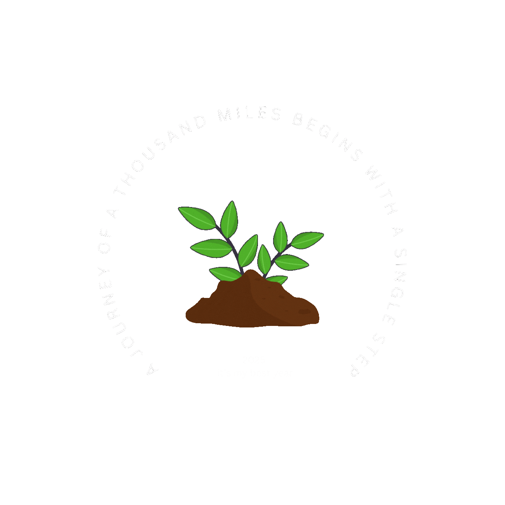

<!-- banner image github_thumnail.png you can change ever you want -->
 ​`
<h1 align="center">   
  🌲 Hi , 💬 Welcome, All Engineer 🔥   
  
           
</h1>
  
   
  
  
<h3 align="center">zzzz | Khmer OCR | Speech2Text | Voice Conversion | zzzz </h3>

 

<!-- right image ( animation gif image right hand side (ok) ) --> 
  

  
 
- 🔭 I’m currently working on AI Project (ASR, TTS, Face, Voice Cloning, NLP, Image Processing ...)🌱

- 🔥 My Tools: Python, Pytorch, Nginx, Caddy, Docker, Cloudflare, Portainer, Flask & Fast API, Termius, wandb ...

- 👯 I’m looking to collaborate on **AI Project**

- 💬 Reach out me through telegram: 0964060587

- 📫 Experience: DayOff, DevOps, MLOps, TurnOff
  
- 🎓 Defense thesis 23/Jun/2025
  
- ⚡ Fun fact **Not give up, doesn't mean you'll success**

- 🌲 Thesis Project: **CRAFT + TrOCR**

 

 
<h2>Activity Graph</h2>

- 💬 My blog post: [soyvitou.bongrean.com](https://soyvitou.bongrean.com/)
- ☁️ Setup Cloudflare: [setup cloudflare self-hosting](https://solstice-goat-844.notion.site/Cloudflare-1cee08028422800f8feef3200a00f73c)

## 🔥 Programming Language and Tools

<table>
<tr>
<td align="center" width="200px"><b>AI/ML & Data Science</b></td>
<td align="center" width="200px"><b>Backend & APIs</b></td>
<td align="center" width="200px"><b>Frontend & Web</b></td>
<td align="center" width="200px"><b>DevOps & Infrastructure</b></td>
<td align="center" width="200px"><b>AI Tools & Platforms</b></td>
</tr>
<tr>
<td align="center"></td>
<td align="center"></td>
<td align="center"></td>
<td align="center"></td>
<td align="center"></td>
</tr>
<tr>
<td align="center"></td>
<td align="center"></td>
<td align="center"></td>
<td align="center"></td>
<td align="center"></td>
</tr>
<tr>
<td align="center"></td>
<td align="center"></td>
<td align="center"></td>
<td align="center"></td>
<td align="center"></td>
</tr>
<tr>
<td align="center"></td>
<td align="center"></td>
<td align="center"></td>
<td align="center"></td>
<td align="center"></td>
</tr>
<tr>
<td align="center"></td>
<td align="center"></td>
<td align="center"></td>
<td align="center"></td>
<td align="center"></td>
</tr>
</table>

###

